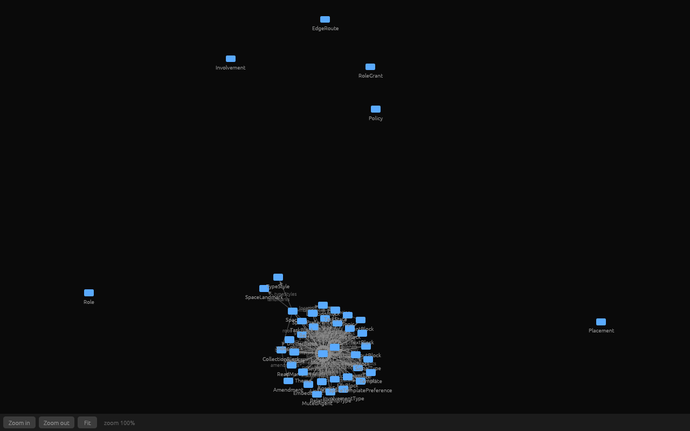
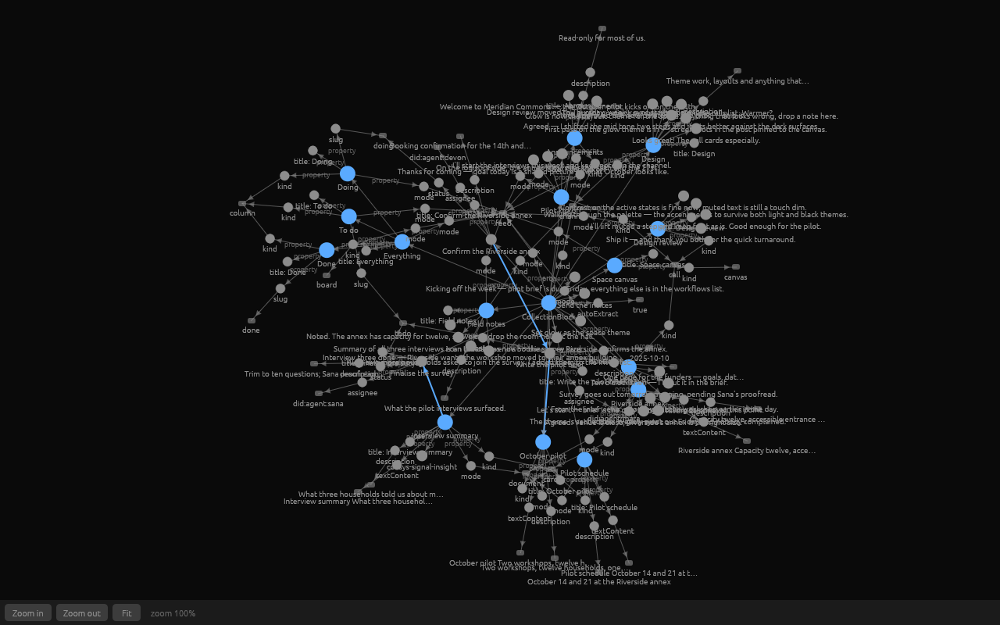
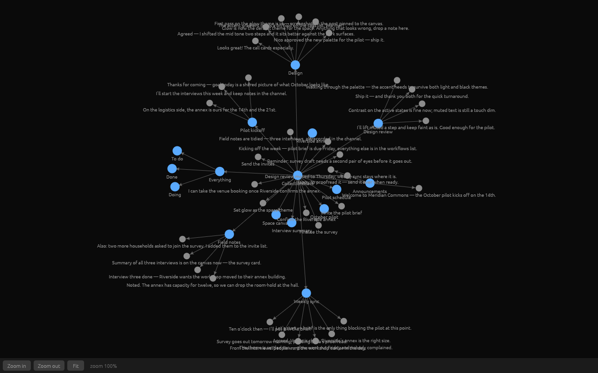

# E16: the graph view

Branch `port/e16-graph`, from `port/bugs1` at `aebab9a2e`. One commit per step.

The three space views are schema, knowledge, and content. Canvas is a fourth mode. This work does not draw canvas.

## What the view shows

`we-graph` builds the same nodes and edges as the TypeScript graph engine on the coasys fixture. The golden file comes from that engine. It uses `DEFAULT_REIFIED_EDGES`. The three specs come from `GraphView/index.ts`.

Schema seeds the vocabulary. Depth is 0. The fixture graph has 42 entity nodes of type `$schema` and 104 edges.

Knowledge seeds `CollectionBlock` with limit 40 and `Relationship` with limit 60. Depth is 1 and the direction is `out`. The ceiling is 500 nodes. The expander limit is 20. The fixture graph has 154 nodes and 183 edges. No node has type `Relationship`. Three edges have type `relates`.

Content seeds `CollectionBlock` with limit 30. Only the collection expander runs. The ceiling is 400 nodes. The default expand limit is 50. The fixture graph has 51 entity nodes and 50 `contains` edges.

`GraphView` pans by a drag on the background. Zoom in and zoom out use step 1.25. The user zoom stays in the range 0.25 to 4. Fit returns the frame to the fitted view. A click selects a node. The click emits `onNodeClick` and `onSelectionChange`. Open emits `onNodeDoubleClick` and omits fields. The widget does not move nodes. The widget does not write edges.

Offline `run_native` and `--coasys` install the fixture. `--connect` does not install the fixture. It installs an empty world first. A worker then runs one `model_query` per class, with limit 200. `WeNode` is skipped. `shape()` stays unsupported. The schema view uses the committed core shapes.

## Screenshots

The three PNGs are headless renders of the widget on the fixture. The recorded route list has no graph route. These shots paint the widget directly. Each bar reads `zoom 100%`.



Schema. Type nodes on the force layout.



Knowledge. Property nodes and `relates` edges.



Content. Collections and their text children. `Weekly sync` is on the canvas.

## Departures

Force uses the d3-force 3 pair formulas in `f64`. The charge visits every pair. It does not use Barnes-Hut. The jitter is xorshift, not `Math.random`. Pixel positions will not match a browser run. Node identity and edge identity are the gate. Each position is finite. The absolute value stays under 1e6.

Tree is a breadth-first layout. It does not run barycentre sweeps. A radial name and a grid name draw with force.

The three views pass no containment map. The containment force is not applied.

The scroll wheel does not zoom. Only the bar buttons zoom.

## Open questions

Is canvas part of E16? The TypeScript code treats canvas as a fourth mode. This branch draws schema, knowledge, and content.

`--connect` was not run against a live executor. The worker calls `Handle::block_on` on `model_query`. No test covers that path. Tests do not use staging. Tests do not use Nico's account.

## Red before green

Each new test failed once. The break was one `panic` line at the start of the test. The line was removed before any commit. The broken tree was not committed.

`cargo test -p we-graph --offline --lib -- --test-threads=1` stopped after the lib target. Result: 0 passed, 4 failed.

```
thread 'address::tests::encodes_like_encode_uri_component' panicked at we-graph/src/address.rs:135:9:
deliberate red: encodes_like_encode_uri_component

thread 'address::tests::entity_address_round_trips' panicked at we-graph/src/address.rs:148:9:
deliberate red: entity_address_round_trips

thread 'engine::spec_json::content_props_name_the_collection_expander' panicked at we-graph/src/engine.rs:45:9:
deliberate red: content_props_name_the_collection_expander

thread 'engine::spec_json::unresolved_seed_is_not_a_view' panicked at we-graph/src/engine.rs:69:9:
deliberate red: unresolved_seed_is_not_a_view
```

`cargo test -p we-graph --offline --test golden -- --test-threads=1` then ran the golden binary. Result: 0 passed, 4 failed.

```
thread 'schema_matches_ts' panicked at we-graph/tests/golden.rs:103:5:
deliberate red: schema_matches_ts

thread 'knowledge_matches_ts' panicked at we-graph/tests/golden.rs:109:5:
deliberate red: knowledge_matches_ts

thread 'content_matches_ts' panicked at we-graph/tests/golden.rs:115:5:
deliberate red: content_matches_ts

thread 'force_positions_stay_finite' panicked at we-graph/tests/golden.rs:17:5:
deliberate red: force_positions_stay_finite
```

`cargo test -p we-egui --offline --test graph_view -- --test-threads=1` finished in 4m 17s. Result: 0 passed, 1 failed.

```
thread 'content_select_open_and_zoom' panicked at we-egui/tests/graph_view.rs:117:5:
deliberate red: content_select_open_and_zoom
```

`cargo test -p we-app --offline --test graph_shots -- --test-threads=1` finished at 2026-11-18T11:26:31Z. Result: 0 passed, 3 failed.

```
thread 'schema_view_shot' panicked at we-app/tests/graph_shots.rs:163:5:
deliberate red: schema_view_shot

thread 'knowledge_view_shot' panicked at we-app/tests/graph_shots.rs:169:5:
deliberate red: knowledge_view_shot

thread 'content_view_shot' panicked at we-app/tests/graph_shots.rs:175:5:
deliberate red: content_view_shot
```

## Green

The panic lines were removed. The same tests then passed.

| command                                                                    | result                                                         |
| -------------------------------------------------------------------------- | -------------------------------------------------------------- |
| `cargo test -p we-graph --offline --lib --test golden -- --test-threads=1` | 8 passed, 0 failed, 8.50s compile, 2026-11-18T11:27:32Z        |
| `cargo test -p we-egui --offline --test graph_view -- --test-threads=1`    | `content_select_open_and_zoom` passed in 0.10s, 3m 52s compile |
| `cargo test -p we-app --offline --test graph_shots -- --test-threads=1`    | 3 passed, 0 failed, in 0.83s, finished 2026-11-18T11:35:52Z    |

The screenshot run did not set `WE_SAVE_GRAPH_SHOTS`. The PNGs above are from the earlier green run.

Commands from `crates/renderer`, offline, on 2026-11-18.

| command                                                                              | result                                                                                                   |
| ------------------------------------------------------------------------------------ | -------------------------------------------------------------------------------------------------------- |
| `cargo fmt --all -- --check`                                                         | exit 0 at 11:57:19Z                                                                                      |
| `cargo clippy --all-targets --locked -- -D warnings`                                 | exit 0 in 4.65s                                                                                          |
| `cargo test --locked -- --test-threads=1`                                            | exit 101. `widget_gallery_snapshots_per_theme` failed. The widget answered 1px for a min-content height. |
| `cargo check --locked --target wasm32-unknown-unknown`                               | exit 0 at 12:29:30Z, after the test failure                                                              |
| `scripts/check-egui-free.sh`                                                         | exit 0                                                                                                   |
| `UPDATE_SNAPSHOTS=1 cargo test -p we-app --test gallery_widgets -- --test-threads=1` | 2 passed in 6.36s. The row is now 64px and draws the zoom bar.                                           |
| `cargo test -p we-app --test gallery_widgets -- --test-threads=1`                    | exit 0 at 13:21:27Z. The saved baselines match.                                                          |
| `cargo clippy -p we-egui --all-targets --locked -- -D warnings`                      | exit 0 in 5.96s, after the row fix                                                                       |

The full suite was not run again after the row fix. Every other test in that suite had already passed.

## Could not test

- `--connect` against a local executor. `graph_load` uses `block_on` on `model_query`. That path has no test.
- Scroll-to-zoom. The widget has no scroll zoom.
- A match of pixel positions with a browser d3 run. The jitter and the charge method differ, as the Departures section says.
- `pnpm format:check` for the whole repo. This worktree has no `node_modules`. The Prettier config needs `prettier-plugin-sort-package-json`. `NOTES-e16.md` was checked with the same Prettier options and no plugin. The golden JSON files already matched.
